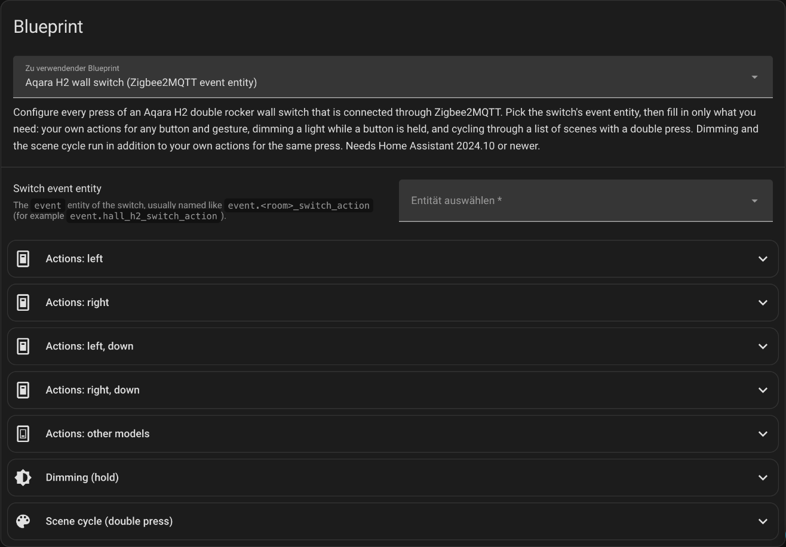

# Aqara H2 wall switch blueprint

This Home Assistant automation blueprint lets you configure every button press of an Aqara H2 double rocker wall switch that is connected through Zigbee2MQTT. For each button and gesture you can run any actions. Built in are dimming a light while a button is held, and cycling through a list of scenes with a double press.

[](https://my.home-assistant.io/redirect/blueprint_import/?blueprint_url=https%3A%2F%2Fgithub.com%2FOliEder%2Faqara-h2-blueprint%2Fblob%2Fmain%2Fblueprints%2Fautomation%2Faqara_h2_switch.yaml)

The button opens the import dialog of your own Home Assistant with this blueprint filled in. It works through My Home Assistant: you must have stored the address of your instance at [my.home-assistant.io](https://my.home-assistant.io) once (the data stays in your browser), and your Home Assistant must have the `my` integration, which is part of the default setup. The first time, My Home Assistant asks for that address. Without the button, follow the steps below.

## Requirements

| What | Detail |
| --- | --- |
| Home Assistant | 2024.10 or newer (`min_version: 2024.10.0`). How this was checked is in [docs/design.md](docs/design.md#minimum-version). |
| Zigbee2MQTT | The switch must appear in Home Assistant as an `event` entity (for example `event.hall_h2_switch_action`). |
| Switch mode | Observed on one device: both rockers were in **decoupled** operation mode (the relays do not switch by themselves) and **multi-click** was on for the lower buttons during all measurements. Both are device settings in Zigbee2MQTT, not in Home Assistant; find them in the device's page in the Zigbee2MQTT frontend (which tab holds them was not checked). The blueprint cannot set them. Assumed, not tested: without multi-click no double press is sent (it was never measured with multi-click off). |

## Which button is which

Zigbee2MQTT names four positions: `left`, `left_down`, `right`, `right_down`. We read `left_down` as the lower button of the left rocker and `left` as its upper button. This is inferred from the naming, not confirmed by the vendor.

## Import and set up, step by step

1. Click the button above, or in Home Assistant open Settings, Automations & Scenes, Blueprints, "Import Blueprint", and enter `https://github.com/OliEder/aqara-h2-blueprint/blob/main/blueprints/automation/aqara_h2_switch.yaml`. Home Assistant remembers the address, so a later "Re-import blueprint" picks up fixes. (Or copy the file into `config/blueprints/automation/`.)
2. Click "Create automation" on the blueprint.

   

   The form after "Create automation" (screenshot from 2026-11-07, German user interface, nothing selected yet): the blueprint, then one group of options per button, and the groups for dimming and the scene cycle.
3. Pick the event entity of your switch (an entity whose name ends in `_action` and whose domain is `event`). Do not pick a sensor or a device.
4. Open the groups you need and fill in only those; everything else stays empty and does nothing.
5. Save. Press a button and look at the automation's trace to see what ran.

## The inputs

Everything is optional except the switch entity.

| Group | Input | What it does | Default | Example |
| --- | --- | --- | --- | --- |
| (top) | Switch event entity | The switch's `event` entity | none, required | `event.hall_h2_switch_action` |
| Actions: left | Single press on left | Your actions on `single_left` | empty | toggle `light.hall` |
| Actions: right | Single press on right | Your actions on `single_right` | empty | |
| Actions: left, down | Single, Double, Hold, Release on left, down | Your actions on `<gesture>_left_down` | empty | |
| Actions: right, down | Single, Double, Hold, Release on right, down | Your actions on `<gesture>_right_down` | empty | |
| Actions: other models | Hold, Double, Release on left and right | Your actions on those 6 events. The tested double rocker was never seen to send them; other models or firmware may. | empty | |
| Dimming (hold) | Light to dim | The light that is dimmed | empty (dimming off) | `light.hall` |
| | Hold dims up | Buttons whose hold raises the brightness | `left_down` | `left_down` |
| | Hold dims down | Buttons whose hold lowers it (up wins if a button is in both lists) | `right_down` | `right_down` |
| | Step size | Percent per step | 10 | 5 |
| | Interval | Seconds between steps | 1 | 0.5 |
| | Safety limit | Seconds after which dimming stops even without a release | 15 | 20 |
| Scene cycle (double press) | Scenes | The scenes, in order | empty (cycle off) | `scene.hall_bright`, `scene.hall_evening`, `scene.hall_night` |
| | Double press cycles scenes | Buttons whose double press activates the next scene | `right_down` | `right_down` |

Dimming and the scene cycle run in addition to your own actions for the same press.

## Examples

**A. Hold the lower left button to dim the hall light up, the lower right button to dim it down.**
Light to dim: `light.hall`. Hold dims up: left, down. Hold dims down: right, down. Step 10 %, interval 1 s (the defaults). Nothing else.

**B. Double press on the lower right button cycles three scenes.**
Scenes: `scene.hall_bright`, `scene.hall_evening`, `scene.hall_night`. Double press cycles scenes: right, down (the default).

**C. Both, plus your own action.**
Examples A and B together; in "Actions: left, down" set "Single press" to a "Toggle" action on `light.hall`.

## What the blueprint does not do

- It does not change device settings (decoupled mode, multi-click, LED, relay, child lock). Those are Zigbee2MQTT device settings; a blueprint reacts to events and has no access to them.
- It does not switch the relays: in decoupled mode the buttons only send events.
- It does not use MQTT or device triggers, because the test tool cannot test those; see [docs/design.md](docs/design.md).

## Known limits

- **Safety limit:** a `hold` is expected to be followed by a `release`. If the release message is lost, dimming stops at the safety limit (default 15 s of real time).
- **Parallel runs:** the automation allows 10 runs at the same time (`mode: parallel`, `max: 10`); further presses at that moment are dropped with a warning in the log. A hold uses one run until its release.
- **Switch goes unavailable** during a hold: dimming ends at once. After the entity comes back with its old timestamp and event type, that old press is ignored, so it is not replayed. If Home Assistant restarts during a hold the run ends with it.
- **Two releases during one slow light call:** the dimming wait looks at the latest event of the switch only. If two rockers are held, and BOTH releases arrive while one light call is still running (the call must be slower than the roughly 0.2 s between the two events), the loop of the first release never sees its own release and dims until the safety limit (default 15 s). Narrow, but reproduced in a test. Options for a fix are in [docs/design.md](docs/design.md#known-limit-two-releases-during-one-slow-light-call).
- **Brightness limits:** each step sends `brightness_step_pct`; what a light does at the minimum or maximum is up to the light. Not checked on a real light.
- **Timers:** steps are timed by Home Assistant; very short intervals (0.1 s) depend on how fast your light answers.
- **Smoothness of dimming:** with the defaults (10 % every second) the light visibly jumps from step to step. On the maintainer's ceiling light, 5 % every 0.5 s was set and looked better (a judgement by eye, not measured). A fading mode (`transition` per step) and the light's own move command are not built; they are planned for 1.1.0 ([issue 1](https://github.com/OliEder/aqara-h2-blueprint/issues/1)); see [docs/design.md](docs/design.md#ideas-not-built-smoother-dimming).

## What was verified and what was not

- Device facts come from one Aqara H2 double rocker on one day (2026-11-07), not confirmed by the vendor; see [docs/device-behaviour.md](docs/device-behaviour.md).
- The blueprint logic is tested in a throw-away Home Assistant with the test tool; see [docs/testing.md](docs/testing.md).
- **Measured on the device and replayed in the tests:** a 10 s hold, two rockers held at the same time, a tap during a hold, double then single on the other rocker.
- **Used on a real instance:** on 2026-11-07 the maintainer installed the blueprint on one Home Assistant instance, for one Aqara H2 double rocker through Zigbee2MQTT, with a ceiling light, a reading light and a closet light, a light strip (not reachable at that time), a blind and an "all lights" action, and reported that the buttons did what was configured. That was a manual check by one person; there is no recording of it, the automation traces of the last five single presses showed no errors, and the dimming runs were not looked at in detail.
- **Not tested:** the light strip (it was not reachable); dimming on other lights; running for weeks; holds longer than 10 s on the device; a Home Assistant restart in the middle of a hold; both releases arriving during a slow light call (known limit above, covered only by a simulated test); older Home Assistant versions than 2026.10.4 (`as_datetime` with a default, templated `wait_template` timeout).

## Run the tests

```sh
uv venv --python 3.14 .venv
uv pip install --python .venv/bin/python -r requirements-dev.txt
.venv/bin/python -m pytest
# the mutation tool takes about 3 to 4 minutes and prints only at the end
.venv/bin/python -m ha_blueprint_test_harness.mutate blueprints/automation/aqara_h2_switch.yaml --timeout 60 \
  -- .venv/bin/python -m pytest -q -x -p no:cacheprovider tests
```

## Maintenance, credits, licence

The YAML is maintained by hand (a script produced the first draft, which is not kept). Credits: Zigbee2MQTT event naming; tests built with `ha-blueprint-test-harness`. Licence: MIT, see [LICENSE](LICENSE). It covers every file in this folder (the blueprint, the tests and the documents). The blueprint file also carries the licence in its first lines, so that it stays licensed when it is copied on its own.

## More documents

- [docs/device-behaviour.md](docs/device-behaviour.md) measured device events
- [docs/design.md](docs/design.md) decisions and reasons
- [docs/testing.md](docs/testing.md) what is tested, what is not, mutation result
- [docs-friction.md](docs-friction.md) notes on the test tool's documentation
